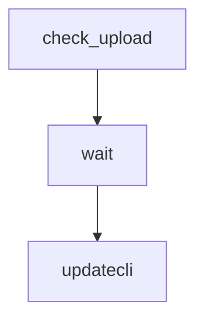

# NPCAP version bump Buildkite pipeline

Checks for a newer NPCAP OEM installer, uploads it to the private GCS bucket,
then opens a pull request to update `NPCAP_VERSION`.

## At a glance

| | |
| --- | --- |
| Platform | Buildkite |
| Source | [`bump-npcap-pipeline.yml`](../bump-npcap-pipeline.yml) |
| Trigger | Enabled weekly schedule on `main`; branch, PR, and tag builds are disabled |

## Purpose

The pipeline automates the NPCAP version update. The first step downloads and
stores the OEM installer if needed. The second step runs Updatecli, which
re-derives the latest release and proposes the `Makefile.common` version
change.

## When it runs

The checked-in pipeline file does not declare its Buildkite-side trigger.
Buildkite API configuration checked 2026-10-20 identifies the pipeline as
`golang-crossbuild-bump-npcap` and reports an enabled weekly schedule on
`main`: `0 4 * * 1 America/New_York`, labeled `Weekly` with message
`Weekly check for new npcap release`. The API reports branch, pull-request,
and tag builds disabled, with trigger mode `none`. The pipeline is not
uploaded by `.buildkite/pipeline.yml`.

## Execution flow

| Job or step | Runs when | Depends on | What it does |
| --- | --- | --- | --- |
| `npcap-check-upload` | Every pipeline run | None declared | Runs `.buildkite/scripts/bump-npcap.sh`; checks the latest public release and uploads a missing OEM artifact after validation. |
| Wait | After the upload step | `npcap-check-upload` | Separates artifact handling from the version bump. |
| `npcap-bump-crossbuild` | After the wait | Wait | Runs Updatecli with `.buildkite/updatecli.d/bump-npcap.yml` to update `Makefile.common` and open a PR. |

## Inputs, outputs, and access

| Item | Details |
| --- | --- |
| Inputs | `UPDATECLI_CONFIG=.buildkite/updatecli.d/bump-npcap.yml`; public NPCAP release metadata; credentials supplied through plugins. |
| Outputs | OEM installer in `gs://golang-crossbuild-ci-internal/private/` when missing; Updatecli may open a pull request labeled `automation`, `dependencies`, and `backport-skip`. |
| Permissions | Google Cloud access uses the Google OIDC plugin. Updatecli uses an ephemeral GitHub token and configures `elastic-ci[bot]` as the Git identity. |
| Secrets | `NPCAP_USERNAME`, `NPCAP_PASSWORD`, and `GITHUB_TOKEN` are provided by Vault-backed plugins. Values are not documented here. |

## Operational notes

The download step verifies that the file is a PE32 executable and checks the
uploaded GCS object's MD5. It skips download/upload when the object already
exists. The Updatecli configuration says it is deliberately kept under
`.buildkite/updatecli.d/`, separate from the GitHub Actions Go-version updater.
Failed builds send a notification to `#ingest-notifications`.
The schedule and build-trigger settings above come from Buildkite API
configuration checked 2026-10-20; the checked-in YAML remains the authority
for step behavior.

## Sources and history

- Pipeline: [`bump-npcap-pipeline.yml`](../bump-npcap-pipeline.yml)
- Scripts: [`bump-npcap.sh`](../scripts/bump-npcap.sh),
  [`run-updatecli.sh`](../scripts/run-updatecli.sh),
  [`common.sh`](../scripts/common.sh)
- Updatecli configuration: [`bump-npcap.yml`](../updatecli.d/bump-npcap.yml)
- Buildkite API configuration checked 2026-10-20: [`golang-crossbuild-bump-npcap`](https://buildkite.com/elastic/golang-crossbuild-bump-npcap)
- History: [`4517625`](https://github.com/elastic/golang-crossbuild/commit/4517625) added the automated NPCAP bump pipeline and scripts.
