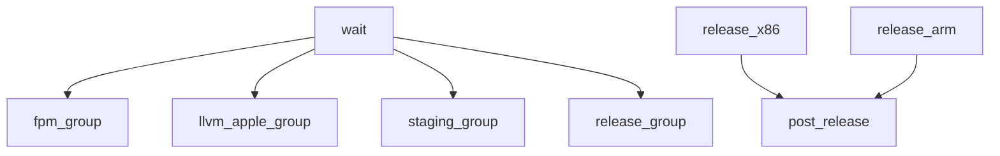

# `golang-crossbuild` Buildkite pipeline

Builds and publishes the repository's cross-build images, and conditionally
uploads the FPM and LLVM Apple image pipelines.

## At a glance

| | |
| --- | --- |
| Platform | Buildkite |
| Source | [`pipeline.yml`](../pipeline.yml) |
| Trigger | Buildkite API branch configuration `main 1.*`, branch/PR/tag builds enabled, and a daily schedule on `main` |

## Purpose

The main pipeline builds staging and release matrices for the supported
Makefiles and architectures. It also uploads the separate FPM and LLVM Apple
pipelines when their branch or changed-file conditions match.

## When it runs

Buildkite API configuration checked 2026-10-20 sets the branch configuration
to `main 1.*` and enables branch, pull-request, and tag builds. Its enabled
pull-request filter is
`build.pull_request.id == null || (build.creator.name == 'elasticmachine' && build.pull_request.id != null)`.
As a result, pull-request builds are limited to pull requests created by
`elasticmachine`; non-pull-request builds pass this filter. The API also
reports an enabled schedule on `main`: `0 12 * * * America/New_York`, labeled
`Daily` with message `Builds once per day`.

Within a running build, the checked-in YAML applies these step conditions:

- FPM is uploaded for pull requests targeting `main` when matching files
  change, or for builds on `main`.
- LLVM Apple is uploaded for pull requests targeting `main` when matching
  files change, or for `main` builds that are not scheduled builds.
- Staging matrix jobs run when `BUILDKITE_PULL_REQUEST` is not the string
  `false`.
- Release matrix jobs apply branch filters: the x86 job allows `main`,
  `N.N...`, and `N.N.N.x` branches; the ARM job allows `main`, `N.N`, and
  `N.N.N.x`.
- The post-release step runs on `main` and `N.N` branches.

## Execution flow

An initial wait separates preceding pipeline steps from the FPM, LLVM Apple,
staging, and release groups. FPM and LLVM Apple configurations are uploaded
dynamically; staging and release commands are declared in this file.

| Job or step | Runs when | Depends on | What it does |
| --- | --- | --- | --- |
| FPM upload | Main branch, or matching PR to `main` | Initial wait | Uploads `.buildkite/fpm-pipeline.yml`; PR uploads use `if_changed` paths. |
| LLVM Apple upload | Main non-scheduled build, or matching PR to `main` | Initial wait | Uploads `.buildkite/llvm-apple-pipeline.yml`; PR uploads use `if_changed` paths. |
| Staging x86 | `BUILDKITE_PULL_REQUEST != "false"` | Initial wait | Builds and publishes a matrix of Makefiles and FIPS variants on GCP x86 agents. |
| Staging ARM | `BUILDKITE_PULL_REQUEST != "false"` | Initial wait | Builds and publishes Debian Makefile and FIPS variants on AWS ARM agents. |
| Release x86 | Branch filter matches | Initial wait | Builds and publishes the x86 Makefile/FIPS matrix and reports a GitHub status. |
| Release ARM | Branch filter matches | Initial wait | Builds and publishes the ARM Makefile/FIPS matrix and reports a GitHub status. |
| Post-Release | `main` or `N.N` branch | Both release matrix steps | Runs `.buildkite/scripts/post-release.sh` to create and push the version tag unless that release tag already exists. |

The matrix build commands call `.buildkite/scripts/build.sh` followed by
`.buildkite/scripts/publish.sh`. Those scripts use the repository Makefiles,
shared helpers, and the configured registry and agent plugins.

## Inputs, outputs, and access

| Item | Details |
| --- | --- |
| Inputs | Build branch, pull-request metadata, changed paths, `GOLANG_VERSION`, and Makefile/FIPS matrix values. |
| Pipeline environment | Buildkite API configuration checked 2026-10-20 sets `ELASTIC_PR_COMMENTS_ENABLED=true`. |
| Outputs | Docker images, GitHub commit statuses, and—on qualifying post-release runs—a pushed version tag. |
| Agents | GCP x86 and AWS ARM agent configurations are declared in the YAML. |
| Plugins | Google OIDC authentication and Vault-backed Docker registry/Docker Hub login plugins. Secret values are not included here. |

## Operational notes

The pipeline uses one automatic retry for the matrix builds. The FPM and LLVM
Apple upload conditions and changed-path lists are local configuration; the
uploaded pipeline execution is described separately on their index pages.

The root file does not define when Buildkite creates builds, nor does it
identify the complete remote pipeline settings. The trigger and schedule
details above come from the Buildkite API configuration, checked 2026-10-20;
the checked-in YAML remains the authority for step behavior. Although the
group is named `Release`, its checked-in steps do not set `RELEASE`; the local
build scripts default `REPOSITORY` to `STAGING_IMAGE` when that variable is
unset. External Buildkite environment settings are not visible here, so the
resulting destination cannot be confirmed from this checkout alone.

## Sources and history

- Main pipeline: [`pipeline.yml`](../pipeline.yml)
- Build and publish helpers: [`build.sh`](../scripts/build.sh),
  [`publish.sh`](../scripts/publish.sh), [`common.sh`](../scripts/common.sh)
- Post-release helper: [`post-release.sh`](../scripts/post-release.sh)
- Related pipeline pages: [FPM](fpm.md), [LLVM Apple](llvm-apple.md)
- Buildkite API configuration checked 2026-10-20: [`golang-crossbuild`](https://buildkite.com/elastic/golang-crossbuild)
- History: [`35c16ef`](https://github.com/elastic/golang-crossbuild/commit/35c16ef) introduced changed-path filtering; [`307a86d`](https://github.com/elastic/golang-crossbuild/commit/307a86d) restricted the pipeline upload to `main`; [`2eb7717`](https://github.com/elastic/golang-crossbuild/commit/2eb7717) kept LLVM Apple off scheduled builds; [`6d4a9cf`](https://github.com/elastic/golang-crossbuild/commit/6d4a9cf) added LLVM release behavior.
