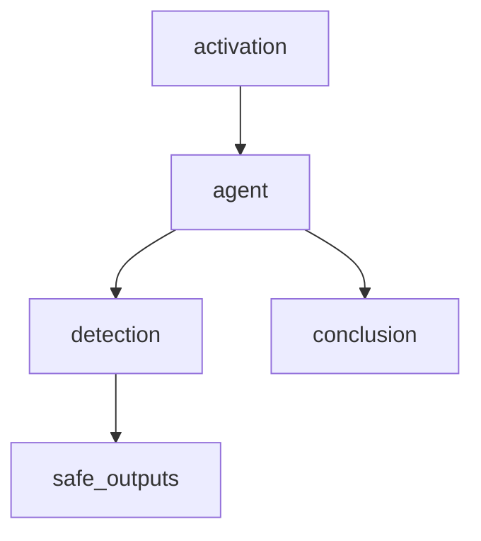

# Debian lifecycle monitor

Checks the lifecycle of Debian versions used by this repository and can open
repo-scoped issues or prepare targeted remediation.

## At a glance

| | |
| --- | --- |
| Platform | GitHub Agentic Workflows on GitHub Actions |
| Source | [`debian-lifecycle.md`](../debian-lifecycle.md); compiled workflow: [`debian-lifecycle.lock.yml`](../debian-lifecycle.lock.yml) |
| Trigger | Monthly on the first day at 00:00 UTC or manual dispatch |

## Purpose

The agent checks the repository's Debian support against lifecycle data and
acts only within `golang-crossbuild`. The source instructions require using
Debian `extendedSupport` when available, avoiding assumptions about ELTS
dates, checking for existing issues, and limiting changes to repository-owned
files.

## When it runs

The source declares a monthly schedule and `workflow_dispatch`. The manual
dispatch has no user-facing inputs. The generated lock file sets the cron to
`0 0 1 * *`.

## Execution flow

The source is compiled by GitHub Agentic Workflows into generated setup,
agent, conclusion, detection, and safe-output jobs.

The agent reads repository support files, fetches lifecycle metadata from
permitted sources, then safe outputs can create a limited number of issues or
pull requests after generated detection gates pass.

| Job or step | Runs when | Depends on | What it does |
| --- | --- | --- | --- |
| `activation` | Every run | None declared | Generated setup and guardrail job. |
| `agent` | Activation permits execution | `activation` | Performs the source-defined lifecycle review. |
| `detection` | Agent was not skipped | `agent` | Generated check before safe outputs. |
| `safe_outputs` | Run is not cancelled, agent was not skipped, and detection succeeds | `agent`, `detection` | Handles the source-configured issue and pull-request outputs. |

## Inputs, outputs, and access

| Item | Details |
| --- | --- |
| Inputs | No user-facing inputs are declared in the source. |
| Outputs | Safe outputs allow up to five issues and two pull requests per run. |
| Permissions | Source requests `contents: read`, `issues: read`, `pull-requests: read`, and `copilot-requests: write`; generated jobs use additional job-scoped permissions as required by the compiler. |
| Network | Source allows default access plus `deb.debian.org`, `en.wikipedia.org`, `endoflife.date`, `wiki.debian.org`, and `www.debian.org`. |

## Operational notes

The source gives the agent GitHub access through `gh-proxy`. It instructs the
agent to keep changes repo-scoped and to avoid modifying downstream projects.
The lock file is generated output; edit the Markdown source, not the lock file.

## Sources and history

- Source: [`debian-lifecycle.md`](../debian-lifecycle.md)
- Generated workflow: [`debian-lifecycle.lock.yml`](../debian-lifecycle.lock.yml)
- Relevant history: [`ad3df0f`](https://github.com/elastic/golang-crossbuild/commit/ad3df0f) added the Debian lifecycle workflow; [`a9c8b98`](https://github.com/elastic/golang-crossbuild/commit/a9c8b98) updated its lifecycle handling.
