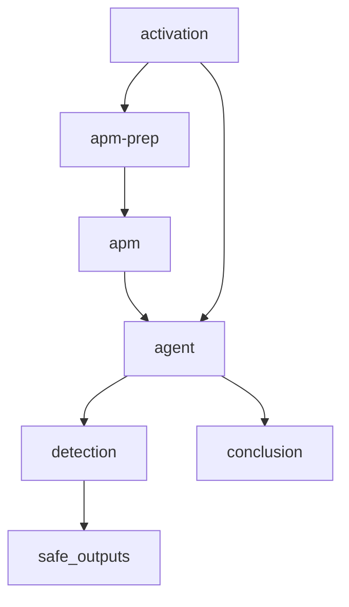

# Build failure report

Reviews recent Buildkite failures for this repository and can create a
repo-scoped issue when an unrecovered failure is found.

## At a glance

| | |
| --- | --- |
| Platform | GitHub Agentic Workflows on GitHub Actions |
| Source | [`debug-build-report.md`](../debug-build-report.md); compiled workflow: [`debug-build-report.lock.yml`](../debug-build-report.lock.yml) |
| Trigger | Weekly on Monday or manual dispatch |

## Purpose

The workflow uses the repository's `debug-build` skill to inspect recent
Buildkite failures, classify them, and prepare an issue following the local
issue-reporting instructions. The skill requires checking whether later
successes recovered failures and reproducing suspected build causes before
classifying them.

## When it runs

The source declares a weekly schedule and manual dispatch. Manual inputs are
`branch` (empty by default, meaning the eligible branches are selected by the
skill) and `lookback_days` (default `7`). The generated workflow resolves the
weekly schedule to Monday at 16:50 UTC and preserves those inputs.

## Execution flow

The generated workflow sets up the agent and imports the local APM package
before investigation. Generated detection and safe-output jobs gate issue
creation.

| Job or step | Runs when | Depends on | What it does |
| --- | --- | --- | --- |
| `activation` | Every run | None declared | Generated setup and guardrail job. |
| `apm-prep` / `apm` | Per generated workflow configuration | `activation` | Packages and restores the declared local APM skill and instruction files. |
| `agent` | Activation permits execution | `activation`, APM setup | Investigates recent Buildkite builds using the source instructions and skill. |
| `detection` | Agent was not skipped | `agent` | Generated check before safe outputs. |
| `safe_outputs` | Run is not cancelled, agent was not skipped, and detection succeeds | `agent`, `detection` | Can create up to one issue; no create-pull-request output is configured. |

## Inputs, outputs, and access

| Item | Details |
| --- | --- |
| Inputs | Manual `branch` and `lookback_days`; scheduled runs use a seven-day lookback and the skill's eligible-branch selection. |
| Outputs | Safe outputs allow at most one issue, with the `observablt-ci` label. |
| Permissions | Source requests `contents: read`, `issues: read`, `pull-requests: read`, and `copilot-requests: write`; generated jobs use additional job-scoped permissions as required by the compiler. |
| Secrets | `BUILDKITE_LOGS_API_TOKEN` is passed to the Buildkite MCP server for read-only log access. The compiled workflow also references generated GitHub Agentic Workflow runtime secrets. |
| Network | Source permits default access and `mcp.buildkite.com`. |

## Operational notes

The source imports [`shared/apm.md`](../shared/apm.md) with the
`elastic/golang-crossbuild/.apm/skills/debug-build` package and
`.apm/instructions/build-debug-issue.instructions.md`. Buildkite access is
read-only; the checked-in source does not authorize triggering or cancelling
Buildkite builds. Reproduction commands in the skill describe investigation
behavior, not commands run by this documentation.

The generated lock file records runtime jobs and permissions. Edit the
Markdown source and regenerate the lock file through the repository's
agentic-workflow process rather than editing generated output directly.

## Sources and history

- Source: [`debug-build-report.md`](../debug-build-report.md)
- Generated workflow: [`debug-build-report.lock.yml`](../debug-build-report.lock.yml)
- Shared APM workflow: [`shared/apm.md`](../shared/apm.md)
- Debug skill: [`SKILL.md`](../../../.apm/skills/debug-build/SKILL.md)
- Issue format: [`build-debug-issue.instructions.md`](../../../.apm/instructions/build-debug-issue.instructions.md)
- Relevant history: [`15c1c21`](https://github.com/elastic/golang-crossbuild/commit/15c1c21) introduced Buildkite failure triage; [`709fb6e`](https://github.com/elastic/golang-crossbuild/commit/709fb6e) added the Docker reproduction requirement; [`cee7e6e`](https://github.com/elastic/golang-crossbuild/commit/cee7e6e) separated issue reporting from the debug skill.
